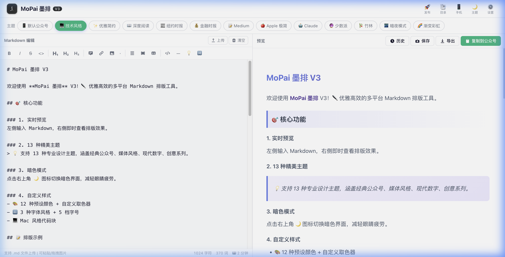
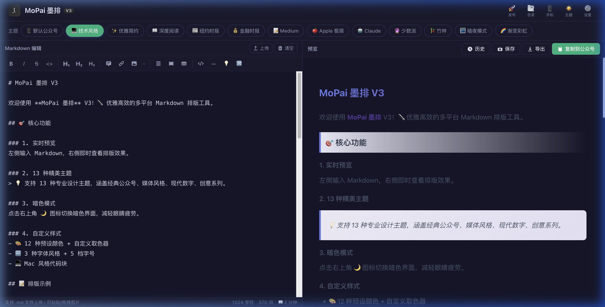
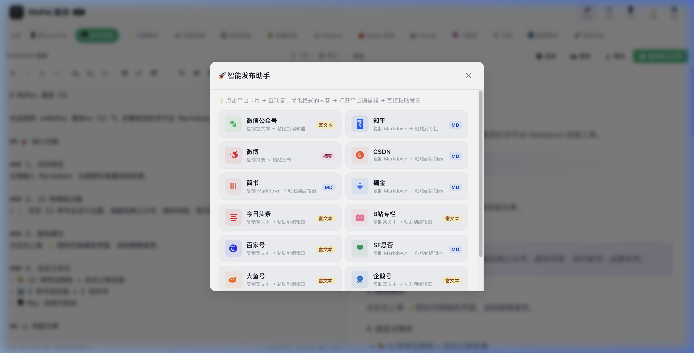
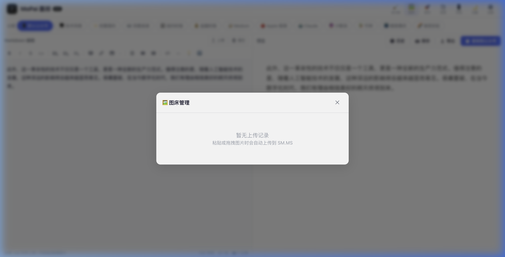
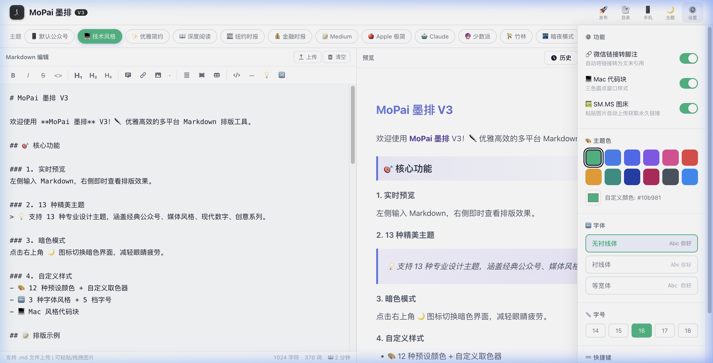

<div align="center">


# MoPai 墨排 ✒️

**不只是排版 —— 一句话让 AI 帮你排版，一键分发 14+ 平台。**

专为公众号 / 知乎 / CSDN 等中文创作者打造的本地 Markdown 排版工具。

[](https://mopai-markdown.vercel.app)

[](https://github.com/ye4wzp/mopai-markdown/actions/workflows/test.yml)
[](LICENSE)


[English](README.en.md) · **中文**



👉 **无需安装，打开即用：<https://mopai-markdown.vercel.app>**

</div>

## 🔥 为什么选 MoPai

「Markdown 转公众号」的工具不少，MoPai 想做的是**从写作到发布的完整闭环**——下面这些是它和纯排版工具不一样的地方：

- 🤖 **AI 排版师 + 10 维去 AI 味** — 「换成适合技术文的主题，主色改微信绿」一句话搞定；内置纯本地离线 10 维 AI 味体检（官腔绕弯、黑话宣传、否定排比、假想敌、借权威、前置铺垫、标题回声、机械清单、复读重复、Burstiness 句长节奏与 MATTR 词丰度）、三档改写力度、事实冻结与改后保真核验、行级 Diff 对比确认，并支持免 Key 一键复制纯正文跳转腾讯朱雀实测 AI 率。
- 📚 **多文档草稿箱（IndexedDB）+ 划词悬浮条** — 支持多篇文章并行撰写、搜索、复制与即时切换，拖选正文即刻呼出悬浮快捷条（加粗 / 斜体 / 行内代码 / 链接 / 仅对选中段去 AI 味）。
- 🔌 **CLI + MCP + 微信草稿箱直发** — 自带零依赖 CLI（`bin/mopai.mjs`）、标准 stdio MCP Server（`bin/mopai-mcp.mjs`）与 `?load=` 注入入口，支持终端/Agent 直接排版、转存图片并一键直发微信公众号草稿箱（`publish-wechat` / `publish_wechat_draft`）。
- 📕 **3:4 小红书自动分页知识卡片** — 原创语义块级智能分页 + 4 套卡片美学风格（墨韵宣纸 / 极简备忘录 / 渐变玻璃 / 暗夜极客），支持 `---` 精确换页、1080×1440 超清单张导出与纯前端零依赖一键打包 ZIP。
- 🖼️ **多图床聚合 + IndexedDB 大图库** — 支持 IndexedDB 本地百 MB 级持久化图库（自动压缩与孤儿清理），以及 GitHub + CDN、SM.MS、自定义 HTTP 上传接口（兼容 PicGo / Lsky Pro / Worker）聚合路由。
- 🚀 **一键分发全平台** — 14 平台按最优格式一键复制；配合 [WechatSync](https://github.com/wechatsync/Wechatsync) 扩展可直接同步到 29+ 平台创建草稿。
- 📱 **手机端深度适配 + 离线 PWA** — `100dvh` 动态视口与刘海安全区适配、iOS `16px` 零缩放输入、中文 IME 安全回车、底部拇指快捷操作栏、单列 Bottom Sheet 抽屉，全站统一线性矢量 SVG 图标系统。
- 🎨 **13 主题 + 深度定制** — 暗色模式（预览区明暗独立隔离不串色）、自定义主题色、字体字号、自定义 CSS。

## 📸 更多预览

| 暗色模式 | 发布助手 |
|:---:|:---:|
|  |  |

| 图床管理 | 设置面板 |
|:---:|:---:|
|  |  |

## ✨ 核心功能

### 📝 编辑器
- **实时预览** — 左侧 Markdown 编辑，右侧即时渲染
- **撤回/重做** — ⌘Z 撤回、⌘⇧Z 重做，最多 50 步历史
- **渲染防抖** — 输入 300ms 后才渲染预览，长文编辑不卡顿
- **格式工具栏** — 加粗、斜体、标题、链接、图片、代码块等一键插入
- **Tab 缩进** — 编辑器支持 Tab/Shift+Tab 缩进
- **查找替换** — ⌘F 打开查找，支持全文替换
- **专注模式** — ⌘\ 隐藏侧边栏，全屏写作
- **行号显示** — 可在设置中开关
- **快捷键** — ⌘B/⌘I/⌘K/⌘S/⌘Z/⌘⇧Z/⌘F/⌘\ 等

### 🎨 主题与样式
- **13 种精美主题** — 默认公众号、技术风格、优雅简约、深度阅读、纽约时报、金融时报、Medium、Apple 极简、Claude、少数派、竹林、暗夜模式、渐变彩虹
- **暗色模式** — 一键切换深色/浅色界面
- **自定义颜色** — 12 种预设色 + 取色器
- **字体设置** — 3 种字体风格 + 5 档字号
- **自定义 CSS** — 高级用户可注入自定义样式
- **Mac 风格代码块** — 带红黄绿圆点的代码块

### 🚀 发布与分发
- **14 平台一键发布** — 微信公众号、知乎、微博、CSDN、简书、掘金、今日头条、B站专栏、百家号、SF思否、大鱼号、企鹅号、小红书、豆瓣
- **🆕 多平台一键分发** — 集成 [WechatSync](https://github.com/wechatsync/Wechatsync) SDK，安装 Chrome 扩展后可一键同步到 29+ 平台
- **智能格式适配** — 自动为每个平台复制最优格式（富文本/Markdown/摘要）
- **一键复制到公众号** — 复制富文本直接粘贴到微信编辑器（⌘⇧C）

### 📱 预览与导出
- **手机预览模式** — 模拟手机屏幕预览排版效果
- **📱 手机端自适应** — 移动端编辑/预览 Tab 切换，完整功能可用
- **导出 HTML** — 完整 HTML 文件
- **导出 PDF** — 打印为 PDF
- **🆕 导出长图** — 完整文档截图导出为 PNG
- **🆕 导出 Word** — 导出 .docx 文件
- **🆕 智能文件名** — 导出文件自动使用文章标题命名
- **同步滚动** — 编辑器与预览区流畅同步滚动

### 🖼️ 图片处理
- **图片粘贴** — ⌘V 粘贴图片，自动嵌入
- **Base64 智能隐藏** — 编辑器内以短占位符显示，预览/导出时还原完整数据
- **SM.MS 图床** — 粘贴图片自动上传获取永久链接（可关闭）
- **拖拽上传** — 直接拖拽图片到编辑器

### 🔧 其他功能
- **浮动大纲目录** — TOC 面板快速跳转
- **微信链接转脚注** — 自动将超链接转为脚注格式
- **Mermaid 图表** — 支持流程图、时序图等
- **模板库** — 内置多种 Markdown 模板
- **草稿自动保存** — 内容自动保存到本地
- **文件上传** — 支持上传 .md 文件
- **字数统计** — 实时显示字数、字符数、阅读时间
- **写作目标** — 设置字数目标，进度条实时追踪
- **PWA 支持** — 可安装为桌面应用离线使用

## 🔄 多平台分发（WechatSync 集成）

MoPai 内置了 [WechatSync](https://github.com/wechatsync/Wechatsync) SDK，支持一键将排版好的文章同步到 29+ 平台。

### 使用步骤

1. 安装 [文章同步助手 Chrome 扩展](https://chrome.google.com/webstore/detail/hchobocdmclopcbnibdnoafilagadion)
2. 在各目标平台的网页端登录账号
3. 在 MoPai 编辑器中写好/排版好文章
4. 点击工具栏「导出 ▾」→「🚀 分发到多平台」
5. WechatSync 弹出同步对话框，勾选目标平台，一键发布

> 自动提取文章标题和首图作为封面，同步为草稿模式，发布前可在各平台二次编辑确认。

## 🤖 AI 助手与去 AI 味

在设置面板填入 API Key（或选择「自定义 (OpenAI 兼容)」填入自己的 Base URL）后，点顶栏「AI」或编辑器右上角「去AI味」打开面板。支持 DeepSeek / 智谱 GLM / SiliconFlow / 通义千问 / OpenAI / OpenRouter 以及任意 OpenAI 兼容中转站或本地模型（Ollama / LM Studio），**配置只存在本机浏览器，不经过任何服务器**。

- **本地 10 维 AI 味体检（免 API Key、离线秒检）** — 参考 `blader/humanizer`、`op7418/Humanizer-zh`、`MrGeDiao/shuorenhua`、`LifelongLazyLearner/qu-ai-wei` 与 `yanstd888/humanizer-lint` 等活跃项目的方法论，自动跳过 frontmatter 与代码块，检出黑话宣传、官腔绕弯、否定排比/假想敌/借权威、前置长状语、元叙事、标题回声、机械加粗清单、句首复读、标点癖与句长突发性（Burstiness CV）/ MATTR 词丰度，支持点击跳转定位与一键本地清理客服残余。
- **腾讯朱雀免 Key 快捷实测** — 一键剔除 Markdown 标记与代码块、复制纯净正文并打开官方[腾讯朱雀 AI 检测](https://matrix.tencent.com/ai-detect/)网页版，粘贴即测真实 AI 率。
- **病灶定向去 AI 味改写** — 4 种口吻（白描干货 / 真人聊天 / 锐评观点 / 极简提纯）× 3 档改写力度（轻修保原句 / 标准去味 / 深度重组），支持全文或划词仅改选中段；改前自动冻结数字/时间/外链锚点，改后自动执行保真核验并展示行级 Diff 与分数降幅，一键应用或撤销。
- **对话式排版操作** — 一句话换主题、改主题色（13 套主题全覆盖）/字体/字号、起标题、写摘要；模型仅能调用 5 个受限白名单函数，**永不 eval**，不可逆操作无法触发。

## 🛠️ CLI 与 MCP Server（零依赖，供脚本与 Agent 直接调用）

除浏览器编辑外，MoPai 内置无第三方依赖的 Node 渲染内核，支持命令行与标准 MCP（stdio JSON-RPC 2.0）直接调用：

```bash
# 列出全部 13 种主题
node bin/mopai.mjs themes

# 命令行直接渲染 Markdown 为带内联样式的公众号 HTML
node bin/mopai.mjs render article.md --theme tech --color "#07c160" --full -o out.html

# 提取标题、字数与大纲（自动跳过代码块中的 # 注释）
node bin/mopai.mjs outline article.md --json

# 预检并直发微信公众号草稿箱（读取环境变量 WECHAT_APP_ID / WECHAT_APP_SECRET）
node bin/mopai.mjs publish-wechat article.md --theme tech --auto-cover --dry-run
WECHAT_APP_ID=xxx WECHAT_APP_SECRET=yyy node bin/mopai.mjs publish-wechat article.md --theme tech

# 零依赖纯 Node 本地服务（替代 python3）
node bin/mopai.mjs serve --port 8080

# 启动 MCP Server（提供 list_themes / render_markdown / format_file / extract_outline / publish_wechat_draft）
node bin/mopai-mcp.mjs
```

Claude Code / Codex / Antigravity MCP 配置示例：

```json
{
  "mcpServers": {
    "mopai": {
      "command": "node",
      "args": ["/path/to/mopai-markdown/bin/mopai-mcp.mjs"]
    }
  }
}
```

## 🔌 外部自动化注入草稿

给 AI 流水线/脚本用的入口：把生成好的 `.md` 放到站点同源目录，然后打开

```
http://localhost:8080/index.html?load=article-assets/my-post/article.md
```

编辑器会强制拉取最新文件（绕开 HTTP 与 Service Worker 缓存）并注入。

- **只接受同源路径**，跨域 URL 会被拒绝
- 注入的标签页草稿存 `sessionStorage`，**与其他标签页互不覆盖**；刷新该页保留已编辑内容
- 放在 `article-assets/` 下的素材不走 SW 缓存，流水线重新生成后立即可见

## 🚀 快速开始

```bash
# 克隆项目
git clone https://github.com/ye4wzp/mopai-markdown.git
cd mopai-markdown

# 启动本地服务器（三选一）
python3 -m http.server 8080
# 或
npx serve -p 8080
# 或
php -S localhost:8080

# 打开浏览器访问
open http://localhost:8080
```

无需安装任何依赖，纯前端项目，开箱即用。

## ⌨️ 快捷键

| 快捷键 | 功能 |
|--------|------|
| `⌘B` | 加粗 |
| `⌘I` | 斜体 |
| `⌘K` | 插入链接 |
| `⌘S` | 保存到历史 |
| `⌘Z` | 撤回 |
| `⌘⇧Z` | 重做 |
| `⌘⇧C` | 复制到公众号 |
| `⌘F` | 查找替换 |
| `⌘\` | 专注模式 |
| `Esc` | 退出专注/查找 |

## 📦 技术栈

- **Vue 3** — CDN 引入，无需构建工具
- **markdown-it** — Markdown 解析引擎
- **Highlight.js** — 代码语法高亮
- **Mermaid.js** — 图表渲染
- **html2canvas** — 长图导出
- **html-docx-js** — Word 导出
- **WechatSync SDK** — 多平台分发
- **原生 CSS** — 无框架依赖，自定义设计系统

## 📁 项目结构

```
mopai-markdown/
├── index.html          # 主页面（含统一 65 符号内联线性 SVG 精灵表）
├── manifest.json       # PWA 配置
├── service-worker.js   # Service Worker（离线缓存）
├── bin/
│   ├── mopai.mjs       # 零依赖 CLI（themes / render / outline / publish-wechat / serve / mcp）
│   └── mopai-mcp.mjs   # 零依赖 stdio MCP Server（含 publish_wechat_draft）
├── lib/
│   ├── renderer.mjs    # Node 渲染内核（复用 js/themes.js）
│   └── wechat-api.mjs  # 微信公众号草稿箱直发模块（token 缓存、图片去重上传、自动封面）
├── css/
│   └── styles.css      # 设计系统、暗色隔离与手机端深度适配
├── js/
│   ├── app.js          # Vue 3 应用主逻辑
│   ├── themes.js       # 13 种主题定义 + 矢量图标 + 示例内容
│   ├── ai-client.js    # LLM 传输层（OpenAI 兼容 + 自定义 Base URL + SSE 流式）
│   ├── humanizer.js    # 本地 10 维 AI 味体检 + 事实冻结保真核验 + 病灶定向改写 + LCS Diff + 朱雀纯正文提取
│   ├── docs-store.js   # IndexedDB 多文档草稿箱
│   ├── media-store.js  # IndexedDB 本地大图库 + 多图床聚合（GitHub CDN / SM.MS / 自定义接口）
│   ├── xhs-cards.js    # 3:4 / 1:1 小红书自动分页知识卡片引擎 + 零依赖 PKZIP 打包器
│   ├── templates.js    # 10 套写作模板库
│   └── publish-utils.js # 发布 HTML 兼容处理（含代码着色内联与 Mermaid 转 PNG）
├── tests/              # Chrome CDP 端到端集成测试（含 375×812 移动端与去 AI 味链路）+ 单元测试
├── screenshots/        # 项目截图
└── README.md
```

## 🙏 致谢

本项目的开发受到以下优秀开源项目的启发：

| 项目 | 作者 | 贡献 |
|------|------|------|
| [花生编辑器 (huasheng_editor)](https://github.com/alchaincyf/huasheng_editor) | [@alchaincyf](https://github.com/alchaincyf) | 项目灵感来源，参考了其 Markdown 转公众号的核心思路 |
| [doocs/md](https://github.com/doocs/md) | [@doocs](https://github.com/doocs) | 参考了其主题设计和排版理念 |
| [Wechatsync](https://github.com/wechatsync/Wechatsync) | [@lljxx1](https://github.com/lljxx1) | 多平台分发 SDK 集成 |
| [markdown-it](https://github.com/markdown-it/markdown-it) | markdown-it 团队 | Markdown 解析引擎 |
| [Highlight.js](https://github.com/highlightjs/highlight.js) | Highlight.js 团队 | 代码语法高亮 |
| [Mermaid](https://github.com/mermaid-js/mermaid) | Mermaid 团队 | 图表渲染支持 |

## 📄 License

[MIT](LICENSE) © 2026 ye4wzp
